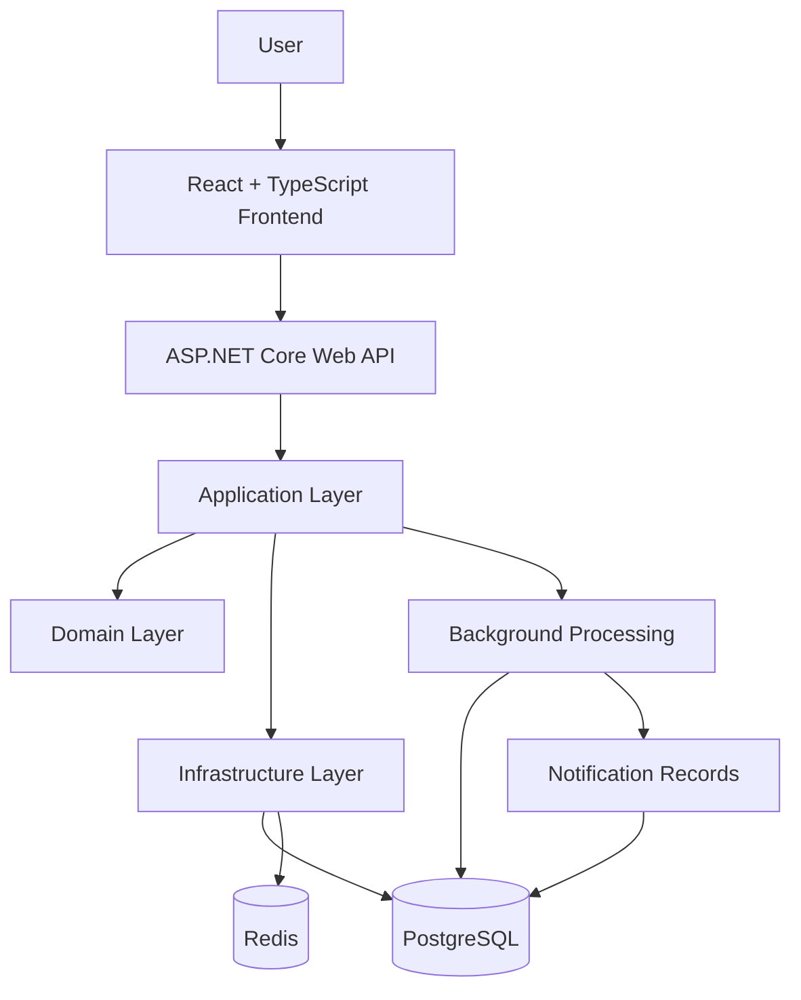

# OpsPilot
### Operations & Incident Management Platform

**OpsPilot** is a full-stack operations and incident management platform designed to help engineering and IT teams track incidents, coordinate responses, monitor service-level agreements (SLAs), and maintain operational visibility through a centralized workspace.

The project aims to demonstrate practical software engineering skills through a maintainable backend architecture, a modern TypeScript frontend, structured data management, role-based access control, background processing, caching, and containerized deployment.

> **Project status:** In development  
> **Project type:** Full-stack portfolio project  
> **Primary focus:** Backend engineering with ASP.NET Core and modern frontend development with React and TypeScript

---

## Table of Contents

- [Overview](#overview)
- [Problem Statement](#problem-statement)
- [Goals and Objectives](#goals-and-objectives)
- [Planned Features](#planned-features)
- [User Roles](#user-roles)
- [Incident Lifecycle](#incident-lifecycle)
- [Technology Stack](#technology-stack)
- [System Architecture](#system-architecture)
- [Core Domain Entities](#core-domain-entities)
- [Engineering Principles](#engineering-principles)
- [Project Structure](#project-structure)
- [Getting Started](#getting-started)
- [Configuration](#configuration)
- [Development Roadmap](#development-roadmap)
- [Testing Strategy](#testing-strategy)
- [Security Considerations](#security-considerations)
- [Documentation](#documentation)
- [Future Improvements](#future-improvements)
- [Author](#author)
- [License](#license)

---

## Overview

Operational incidents can disrupt services, affect customers, and create additional work for engineering teams when incident information is scattered across different tools.

OpsPilot aims to address this problem by providing a centralized platform for managing the incident lifecycle, assigning ownership, recording investigation activities, monitoring SLA deadlines, and documenting resolutions.

The platform is designed around practical operational workflows rather than a simple CRUD application. Its planned capabilities include role-based permissions, incident activity history, automated SLA breach detection, notifications, dashboard metrics, and post-incident documentation.

The long-term objective is to build a maintainable application that reflects real-world software engineering practices and can be extended as operational requirements evolve.

## Problem Statement

Engineering and IT operations teams need a reliable way to coordinate incident response and preserve operational knowledge.

Common challenges include:

- Limited visibility into active and unresolved incidents.
- Unclear incident ownership and response responsibilities.
- Difficulty tracking investigation progress and status changes.
- Missed service-level agreement deadlines.
- Inconsistent communication and incomplete incident histories.
- Limited visibility into recurring issues and operational performance.
- Insufficient documentation of root causes and corrective actions.

OpsPilot is intended to bring these workflows together in one application, giving teams a clearer view of incidents, responsibilities, and resolution progress.

## Goals and Objectives

The project focuses on the following engineering objectives:

- Build a structured REST API using ASP.NET Core and C#.
- Apply separation of concerns across domain, application, infrastructure, and API layers.
- Develop a responsive frontend using React and TypeScript.
- Implement authentication and role-based authorization.
- Model incident workflows and business rules explicitly.
- Introduce background processing for SLA monitoring and notifications.
- Use PostgreSQL for persistent application data and Redis for appropriate caching or supporting workloads.
- Apply automated testing, structured logging, and configuration management.
- Prepare the application for containerization and deployment.

## Planned Features

The following capabilities represent the intended product scope. Their implementation status will evolve throughout development.

### 1. Authentication and Access Control

- User authentication.
- Role-based access control.
- Team membership and access restrictions.
- Protected API endpoints.
- Authenticated frontend routes.

### 2. Incident Management

- Create and report incidents.
- View incident lists and detailed incident information.
- Search, filter, and organize incidents.
- Assign incidents to responsible teams or responders.
- Track incident status and investigation progress.
- Add comments and investigation updates.
- Maintain an incident activity timeline.

### 3. SLA Monitoring

- Define SLA policies and incident deadlines.
- Calculate deadlines according to server-side rules.
- Detect SLA breaches through background processing.
- Record breach events and prevent duplicate breach notifications.
- Display relevant SLA information to authorized users.

### 4. Notifications

- Notify users about relevant incident events.
- Surface SLA breach notifications.
- Track read and unread notification states.
- Provide a centralized notification interface.

### 5. Operational Dashboard

- Display incident overview metrics.
- Show incidents grouped by status and priority.
- Highlight unresolved and overdue incidents.
- Provide visibility into team workload and incident trends.

### 6. Post-Incident Reviews

- Document incident summaries.
- Record root causes and contributing factors.
- Capture corrective and preventive actions.
- Preserve lessons learned for future incident prevention.

---

## User Roles

The initial authorization model includes three roles.

| Role | Intended Responsibilities |
|---|---|
| **Admin** | Manage users, teams, access policies, and administrative settings. |
| **Responder** | Investigate assigned incidents, update incident status, add comments, and contribute to resolution. |
| **Viewer** | View permitted incident information and operational dashboards without modifying incident records. |

Authorization will be enforced on the backend. Frontend visibility controls are intended to improve the user experience but will not replace server-side permission checks.

The exact permissions for each operation will be defined by the project requirements and API contract.

## Incident Lifecycle

OpsPilot uses the following planned incident lifecycle:

```text
Open
  |
  v
Investigating
  |
  v
Resolved
  |
  v
Closed
```

- **Open:** An incident has been reported and requires attention.
- **Investigating:** A responder or team is actively investigating the issue.
- **Resolved:** A resolution has been applied and recorded.
- **Closed:** The incident workflow has been formally completed.

Status transitions will be validated by the backend according to documented business rules. Invalid transitions should be rejected rather than silently accepted.

## Technology Stack

### Backend

| Technology | Purpose |
|---|---|
| C# | Primary backend programming language |
| ASP.NET Core Web API | REST API and HTTP request handling |
| Entity Framework Core | Object-relational mapping and database access |
| PostgreSQL | Relational application database |
| Redis | Caching and supporting workloads where appropriate |
| Background Services | Asynchronous SLA monitoring and notification processing |

### Frontend

| Technology | Purpose |
|---|---|
| React | User interface development |
| TypeScript | Type-safe frontend development |
| Vite | Development server and build tooling |
| Tailwind CSS | Utility-first styling |
| shadcn/ui with Base UI | Reusable interface components |
| React Router | Client-side navigation |
| TanStack Query | Server-state fetching and caching |
| React Hook Form | Form state management |
| Zod | Runtime schema validation |
| Recharts | Data visualization |
| Lucide React | Icons |
| Fetch API | HTTP communication with the backend |

### Development and Delivery

| Technology | Purpose |
|---|---|
| Git and GitHub | Version control and source code hosting |
| Docker | Containerization |
| Automated tests | Verification of business rules and application behavior |
| Structured logging | Troubleshooting and operational visibility |

The stack reflects the intended architecture. Individual tools and integrations will be introduced and verified as implementation progresses.

---

## System Architecture

OpsPilot is designed as a frontend application communicating with a REST API backed by a relational database.



### Architectural Layers

**API Layer**
- Exposes HTTP endpoints.
- Handles request and response contracts.
- Applies authentication and endpoint authorization.
- Coordinates incoming requests with application services.

**Application Layer**
- Orchestrates use cases.
- Coordinates business operations.
- Handles application-level validation and workflow execution.

**Domain Layer**
- Defines core business concepts and rules.
- Models incident behavior and valid status transitions.
- Keeps domain logic independent of infrastructure concerns where practical.

**Infrastructure Layer**
- Implements persistence using Entity Framework Core and PostgreSQL.
- Integrates Redis where appropriate.
- Provides supporting implementations for background processing and other external dependencies.

The architecture is intended to keep responsibilities separated and make the system easier to test, maintain, and extend.

---

## Core Domain Entities

The initial domain model includes the following entities.

| Entity | Responsibility |
|---|---|
| `User` | Represents a user account and associated identity information. |
| `Team` | Represents a team responsible for operational work. |
| `Incident` | Stores incident details, ownership, status, and relevant deadlines. |
| `IncidentComment` | Stores discussion and investigation updates associated with an incident. |
| `IncidentActivity` | Records significant incident events and workflow changes. |
| `Notification` | Stores user-facing notifications and read states. |
| `IncidentSlaBreach` | Records detected SLA breach events. |
| `Postmortem` | Stores post-incident analysis and corrective actions. |

These entities form the initial conceptual model. Their properties, relationships, database constraints, and API representations will follow the detailed design documents.

## Engineering Principles

OpsPilot is being developed with the following principles in mind.

### Separation of Concerns

Business rules, HTTP handling, persistence, and presentation should remain in clearly defined areas of the application.

### Server-Side Business Rules

Critical decisions, including authorization, incident status transitions, SLA deadlines, and ownership validation, must be enforced by the backend.

### Maintainable API Contracts

Endpoints and DTOs should have explicit request and response shapes. Frontend integration should follow the actual backend contract instead of relying on assumptions.

### Data Integrity

Database constraints, validation, and appropriate transactional boundaries should protect application consistency.

### Observable Background Processing

Background jobs should be designed with logging, failure handling, and duplicate-processing safeguards where relevant.

### Type Safety

TypeScript types and validation schemas should make frontend behavior easier to understand and reduce avoidable runtime errors.

### Incremental Delivery

Features should be implemented in small, testable vertical slices. Each slice should be validated before unrelated functionality is introduced.

---

## Project Structure

The repository uses a monorepo layout so the backend, frontend, and project documentation can be maintained together.

```text
OpsPilot/
├── docs/
│   ├── overview.md
│   ├── features-and-requirements.md
│   ├── use-case-and-flows.md
│   ├── api-and-entity-design.md
│   └── implementation-flow.md
├── api/
│   ├── api.sln
│   └── api/
│       └── api.csproj
├── frontend/
│   ├── public/
│   ├── src/
│   ├── package.json
│   └── vite.config.ts
├── .gitignore
└── README.md
```

The exact structure may evolve as the implementation progresses.

---

## Getting Started

The following instructions describe the intended local development workflow. They assume the backend and frontend setup has been completed and the required dependencies are available.

### Prerequisites

Install the following tools:

- [.NET SDK](https://dotnet.microsoft.com/download) compatible with the backend target framework.
- [Node.js](https://nodejs.org/) compatible with the installed Vite version.
- npm.
- [PostgreSQL](https://www.postgresql.org/download/).
- [Redis](https://redis.io/) if required by the current implementation.
- [Git](https://git-scm.com/).
- [Docker](https://www.docker.com/) for containerized development when configured.

### 1. Clone the Repository

```bash
git clone https://github.com/Haikalfkri/OpsPilot.git
cd OpsPilot
```

Replace the placeholder with the actual repository URL.

### 2. Configure the Backend

Open `api/api.sln` in Visual Studio, or navigate to the backend project directory in a terminal:

```bash
cd api
dotnet restore
```

Build the solution:

```bash
dotnet build api.sln
```

Apply database migrations after the database connection and migration setup have been configured:

```bash
dotnet ef database update --project api --startup-project api
```

This migration command assumes the EF Core tooling is installed and migrations have been created. Adjust the project paths if the solution structure changes.

Run the API:

```bash
dotnet run --project api
```

The actual API URL depends on the configured launch profile and application settings. Check the terminal output or `Properties/launchSettings.json`.

### 3. Configure the Frontend

Open another terminal from the repository root:

```bash
cd frontend
npm install
```

Create a local `.env` file if the frontend uses environment variables. For example:

```env
VITE_API_BASE_URL=http://localhost:5000
```

Replace the example URL with the actual URL of the running backend.

Start the development server:

```bash
npm run dev
```

Open the local URL printed by Vite.

### 4. Verify the Build

From the `frontend/` directory:

```bash
npm run build
```

From the backend solution directory:

```bash
dotnet build api.sln
```

Successful builds verify compilation but do not, by themselves, guarantee that database connectivity, authentication, or end-to-end workflows are working.

---

## Configuration

Application settings should be supplied through local configuration and environment variables.

Typical configuration categories include:

- Database connection strings.
- Redis connection settings.
- Authentication and token settings.
- Frontend API base URL.
- Logging levels.
- Background worker settings.

Do not commit real passwords, access tokens, signing keys, or production connection strings to source control.

Local `.env` files and development secrets should be excluded from Git where appropriate. Production secrets should be stored in the hosting platform's secret-management or environment-configuration facilities.

## Development Roadmap

The planned implementation sequence is:

- [ ] **Phase 1 — Foundation:** Verify project structure, establish application conventions, configure persistence, and validate the development environment.
- [ ] **Phase 2 — Authentication and Authorization:** Implement authentication, roles, team membership, and protected endpoints.
- [ ] **Phase 3 — Incident Management:** Implement incident creation, listing, filtering, details, assignments, comments, and status transitions.
- [ ] **Phase 4 — Activity History:** Record important incident changes and expose the activity timeline.
- [ ] **Phase 5 — SLA Monitoring:** Configure deadlines, implement breach detection, and handle duplicate processing.
- [ ] **Phase 6 — Notifications:** Implement notification creation and read/unread behavior.
- [ ] **Phase 7 — Dashboard:** Provide incident metrics and operational summaries.
- [ ] **Phase 8 — Postmortems:** Support incident reviews and corrective action documentation.
- [ ] **Phase 9 — Quality and Delivery:** Expand automated tests, improve error handling, configure Docker, and prepare deployment.

This roadmap represents the intended sequence, not a claim that any phase is already complete. Actual progress should be assessed against the implementation flow and existing source code.

## Testing Strategy

Testing will be introduced alongside implementation rather than postponed until the end.

The intended strategy includes:

- **Unit tests:** Verify domain behavior, validation, and incident status transitions.
- **Integration tests:** Verify API behavior, persistence, and relevant infrastructure interactions.
- **Authorization tests:** Verify that users cannot perform operations outside their permissions.
- **Frontend validation:** Verify TypeScript checks, production builds, form validation, and important UI states.
- **End-to-end verification:** Validate critical workflows across the frontend and backend as the application matures.

Important workflows should include incident creation, assignment, investigation, resolution, closure, SLA breach handling, and notification behavior.

## Security Considerations

Security is a core requirement rather than a frontend-only concern.

The implementation should account for:

- Server-side authentication and authorization.
- Validation of incoming requests.
- Team and resource-level access checks.
- Safe handling of authentication credentials and secrets.
- Secure CORS configuration for deployed environments.
- HTTPS in production.
- Database access controls and appropriate configuration management.
- Protection against duplicate or unauthorized state-changing requests.
- Avoidance of sensitive information in logs and error responses.

Security controls should be verified through implementation and testing before the application is used with real operational data.

## Documentation

Project design and implementation guidance are maintained in `project-docs/`.

| Document | Purpose |
|---|---|
| `overview.md` | Project purpose, scope, and architecture overview. |
| `features-and-requirements.md` | Functional requirements and feature definitions. |
| `use-case-and-flows.md` | User workflows and incident processes. |
| `api-and-entity-design.md` | API contracts, domain entities, and data relationships. |
| `implementation-flow.md` | Development phases and implementation sequence. |

These documents serve as the initial reference for implementation. When requirements and existing code appear inconsistent, the discrepancy should be reviewed and resolved explicitly rather than handled through assumptions.

## Future Improvements

Potential future enhancements may include:

- More detailed operational analytics.
- Advanced incident search and filtering.
- Configurable SLA policies.
- Additional notification delivery channels.
- Audit reporting and export capabilities.
- Improved observability and health checks.
- Automated CI/CD workflows.
- Performance testing and caching optimization.
- Additional integrations with external monitoring or ticketing systems.

These enhancements are candidates for future development and are not part of the initial guaranteed scope.

## Author

**Haikal Fikri**

Software Engineering | Backend Development | Full-Stack Engineering

This project is being developed as a practical demonstration of software engineering skills, architectural design, and the implementation of a real-world operational workflow.

## License

The project's license has not yet been specified.

Before making the repository publicly available, choose an appropriate license and add a `LICENSE` file if you intend to grant others permission to use, modify, or distribute the code.
